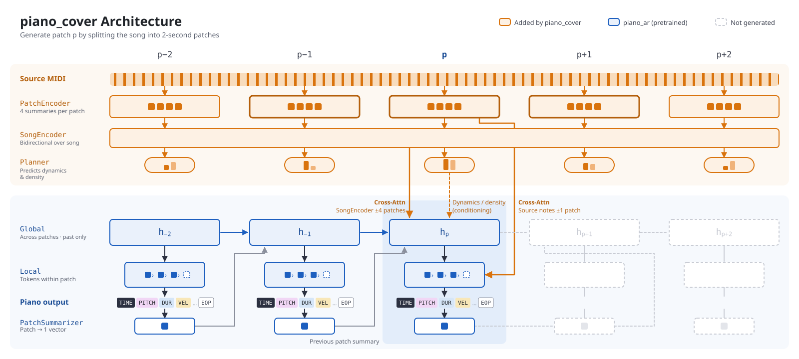
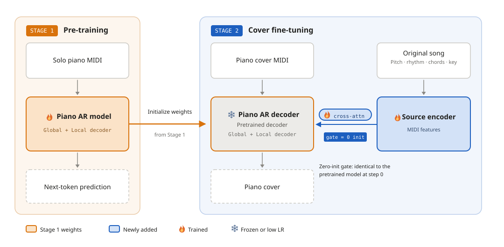

# music-cover

**Generate piano covers of pop songs as MIDI.** The system first transcribes an audio track into multi-instrument MIDI using [tsumugi](https://github.com/anime-song/tsumugi), then generates an arrangement using an autoregressive piano model pretrained on ~3,000 hours of piano performances.

[日本語 README](docs/README_ja.md) | [](LICENSE) | [](https://huggingface.co/anime-song/tsumugi-piano-cover-v2) | [](https://colab.research.google.com/github/anime-song/tsumugi-piano-cover/blob/main/notebooks/cover_studio_colab_en.ipynb)

- 🎹 **Aligned to Original Timeline**: Play back covers synchronously with the original audio track.
- 🎚️ **Controllable Arrangements**: Fine-tune fidelity to the source, dynamics, fills, pitch range, and performer styles.
- 🔁 **Cover Studio**: Interactive web UI for iterative generation, comparing takes, and inpainting/regenerating from any point.

## 📢 Updates

- **2026-10-21 — Sheet music from covers** (`piano_perf2score/` in [anime-song/tsumugi-piano-cover-v2](https://huggingface.co/anime-song/tsumugi-piano-cover-v2))
  - A V2 cover can now be turned into a two-staff piano score (MusicXML), with bar lines on the beats of the original, chord symbols, and tempo markings.
  - In Cover Studio, open a take and press **Make score**. The score is drawn in the browser ([Verovio](https://www.verovio.org/)), so no notation software is needed; download it as MusicXML or print it to PDF.
- **2026-10-20 — V2 released** ([anime-song/tsumugi-piano-cover-v2](https://huggingface.co/anime-song/tsumugi-piano-cover-v2))
  - **Fewer rhythm breakdowns**: covers are now generated bar by bar on the beat grid estimated by [SheetSage2-Refined](https://huggingface.co/anime-song/SheetSage2-Refined).
  - **Closer to the original**: the melody is reproduced more faithfully, because the model also reads the SheetSage2-Refined melody and audio features of the original recording.
  - Cover Studio and the Colab notebooks use V2 by default. V1 can still be selected, and works with a MIDI file alone (V2 needs the original audio).
  - The API, architecture, and training sections below describe V1. See the [V2 model card](https://huggingface.co/anime-song/tsumugi-piano-cover-v2) for V2 usage and details.

---

## Quick Start

### Google Colab

The fastest way to get started is the Colab notebook ([English](https://colab.research.google.com/github/anime-song/tsumugi-piano-cover/blob/main/notebooks/cover_studio_colab_en.ipynb) / [日本語](https://colab.research.google.com/github/anime-song/tsumugi-piano-cover/blob/main/notebooks/cover_studio_colab_ja.ipynb)). Select a GPU runtime, run the first cell, and open **Cover Studio** to transcribe, generate, compare, and download covers directly from your browser.

### Local Installation

Requires Python 3.12 and an NVIDIA GPU (CPU is supported but significantly slower).

```bash
git clone https://github.com/anime-song/tsumugi-piano-cover.git
cd tsumugi-piano-cover
python -m venv .venv
.venv/bin/pip install -r music-backend/requirements.txt     # Windows: .venv\Scripts\pip
.venv/bin/pip install -e ./music-backend
# Windows: .venv\Scripts\pip install -e .\music-backend
.venv/bin/python -m cover_studio --host 0.0.0.0
# Windows: .\.venv\Scripts\python -m cover_studio --host 0.0.0.0
```

Model weights are downloaded automatically from Hugging Face on the first run. The backend can serve its prebuilt web app from GitHub Releases without Node.js. For local web development, run the Expo frontend as described below.

### Expo app

The backend command starts the API at port `8100` without opening a browser. To open the Studio UI, run Expo separately; it serves the app at `http://localhost:8081` (or through its QR code on a phone):

```powershell
cd .\music-frontend
npm ci
npm start
```

`npm start` serves the web app at `http://localhost:8081`. For the native app and Expo QR code, run `npm run start:native`. For a physical phone, Expo uses the computer's LAN address for the backend by default. Set `EXPO_PUBLIC_API_URL=http://<computer-lan-ip>:8100` in `music-frontend/.env.local` only if you need to override it. The interface is bundled into Expo through [Expo DOM components](https://docs.expo.dev/guides/dom-components/).

To enable audio transcription within Cover Studio, set up tsumugi in `.tsumugi/tsumugi`:

```bash
git clone https://github.com/anime-song/tsumugi.git .tsumugi/tsumugi
cd .tsumugi/tsumugi
uv sync --locked --extra stem
```

Cover Studio automatically detects tsumugi and runs it using tsumugi's Python environment (custom path configurable via `--tsumugi-dir`). On Windows, torchcodec requires shared FFmpeg libraries; place them in `.tsumugi/ffmpeg-shared/bin` or specify `--ffmpeg-dir`. If you already have a transcribed MIDI file, you can upload it directly with the audio without installing tsumugi.

---

## Cover Studio

The shared Cover Studio UI in `music-frontend/src/` contains the piano roll, synchronized audio/MIDI playback, generation controls, style learning, take comparison, and score viewer.

---

## Python API & CLI

```python
from piano_cover.generate import CoverParams, generate_covers, prepare_source
from piano_cover.model import CoverModel

model = CoverModel.from_pretrained(device="cuda")  # anime-song/tsumugi-piano-cover
source = prepare_source("song.mid", model.tokenizer, model.config)  # tsumugi multi-track MIDI
cover = generate_covers(model, source, CoverParams(seconds=60, fill=2.5))[0]
model.tokenizer.events_to_midi(cover.events, "cover.mid")
```

```bash
python -m piano_cover.generate --checkpoint anime-song/tsumugi-piano-cover --source song.mid --seconds 60
python -m piano_ar.generate --checkpoint anime-song/tsumugi-piano-cover --seconds 60   # Unconditioned solo piano
```

The source MIDI must be transcribed with stem separation, instrument refinement, velocity estimation, and beat/chord/key detection enabled (matching training data conditions). [`music-backend/apps/cover_studio/tsumugi_worker.py`](music-backend/apps/cover_studio/tsumugi_worker.py) implements this exact pipeline.

### Generation Parameters

| Parameter | Default | Description |
| --- | --- | --- |
| `source_cfg` | 2.0 | Classifier-Free Guidance scale on source MIDI. Higher values track melody and harmony more strictly |
| `onset_bias` | 0.0 | Bias pulling generated note onsets toward source note onsets (values around 4.0 recommended) |
| `dynamics` / `density` | 2.0 / 1.0 | Scaling factors for predicted velocity and note-density trajectories |
| `fill` / `above` / `span` | 2.0 / 0.0 / 1.5 | Offsets for fill frequency, notes above melody, and register range (in standard deviations) |
| `channel` / `channel_cfg` | 0 / 3.0 | Performer index (0 = unconditioned) and conditioning strength |
| `temperature` / `top_p` | 1.0 / 0.90 | Sampling parameters |
| `seconds` | full song | Target duration to generate (useful for quick previews) |

---

## Architecture



- **Two-Stage Generation**: Songs are processed in **2-second patches**. A Global Transformer autoregressively plans across patches, while a Local Transformer generates individual note events (time, pitch, duration, velocity, pedal) within each patch at 10 ms resolution.
- **Source Conditioning**: Input songs are transcribed into **tsumugi multi-instrument MIDI** (all tracks including drums, along with beat grids, chords, and key signatures), summarized per patch, and encoded across the entire song.
- **Gated Cross-Attention**: The decoder attends to the source via gated cross-attention layers (initialized with zero gates). The Global model attends to contextual song encodings, and the Local model attends to individual source notes.
- **Arrangement Planner**: Predicts velocity, density, and arrangement feature curves from the source track to condition decoding. Dynamics and arrangement sliders scale these trajectories.
- **Unaligned Training**: Cover MIDI is **not time-stretched** to the original audio during training. Alignment between cover and source is solely used to index cross-attention windows, preventing rhythm distortion from alignment artifacts.



1. **Pretraining (`piano_ar`)**: ~3,000 hours of solo piano MIDI, including transcribed acoustic performances, PiJAMA, Pop2Piano (piano tracks), PIAST, and MAESTRO.
2. **Fine-Tuning (`piano_cover`)**: ~3,000 piano covers (~190 hours across ~780 songs) paired with tsumugi transcriptions of the original audio.

*Note: Training datasets are not redistributed.*

---

## Repository Structure

| Directory | Description |
| --- | --- |
| [`music-backend/apps/piano_ar/`](music-backend/apps/piano_ar) | Autoregressive piano performance model (tokenizer, architecture, pretraining) |
| [`music-backend/apps/piano_cover/`](music-backend/apps/piano_cover) | Cover generation model (source encoder, Planner, preprocessing, training, inference) |
| [`music-backend/`](music-backend) | Python models, backend server, tests, projects, and Python configuration (`pyproject.toml`, `requirements.txt`, `uv.lock`) |
| [`music-backend/apps/cover_studio/`](music-backend/apps/cover_studio) | Cover Studio backend server (FastAPI) and tsumugi worker |
| [`music-frontend/src/`](music-frontend/src) | Shared Cover Studio UI source and Expo Router routes |
| [`music-frontend/`](music-frontend) | Expo Router app for web, Android, and iOS |
| [`docs/`](docs) | Documentation, Japanese README, and images |
| [`notebooks/`](notebooks) | Google Colab notebooks |
| [`music-backend/apps/piano_score/`](music-backend/apps/piano_score) | Score tokenizer, MusicXML reader/writer, and the score language model |
| [`music-backend/apps/piano_perf2score/`](music-backend/apps/piano_perf2score) | Performance-to-score model (turns covers into MusicXML) |

To export custom checkpoints to the release format: `python -m piano_cover.export --checkpoint <best.pt> --out <dir>` (or `piano_ar.export` for the base piano model).

---

## Limitations

- Transcription inaccuracies in the source MIDI (melody, beat grid, chord labels) directly affect generation. Metric rhythm strongly depends on source beat tracking.
- Swing rhythms may be rendered straight.
- Sustain pedal durations tend to be longer than human performances.
- The cover model outputs expressive MIDI performances. The score model writes what was played, so doublings and wide voicings of the cover stay in the score.

## License

- Code: [MIT License](LICENSE)
- Model Weights ([V2](https://huggingface.co/anime-song/tsumugi-piano-cover-v2) / [V1](https://huggingface.co/anime-song/tsumugi-piano-cover)): [CC BY-NC 4.0](https://creativecommons.org/licenses/by-nc/4.0/) (Non-Commercial Use Only). [SheetSage2-Refined](https://huggingface.co/anime-song/SheetSage2-Refined), which V2 uses for beats and melody, is also non-commercial.

## Acknowledgements

- [tsumugi](https://github.com/anime-song/tsumugi) — Multi-instrument automatic music transcription
- [SheetSage2-Refined](https://huggingface.co/anime-song/SheetSage2-Refined) — Beat and melody estimation (V2)
- [smplr](https://github.com/danigb/smplr) — In-browser piano sample player
- [Verovio](https://www.verovio.org/) — In-browser music engraving for the score view
- [PERiScoPe](https://huggingface.co/datasets/SyMuPe/PERiScoPe) — Aligned performances and scores (score model training)
- [audio2chordpro](https://github.com/anime-song/audio2chordpro) — Architecture reference for Cover Studio
